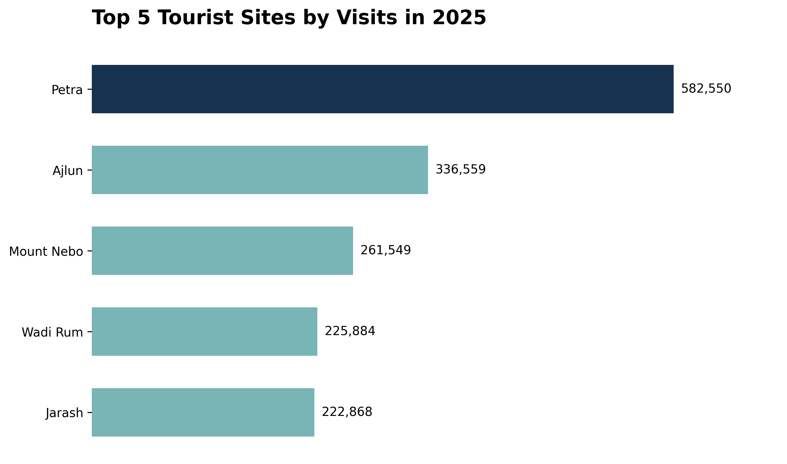
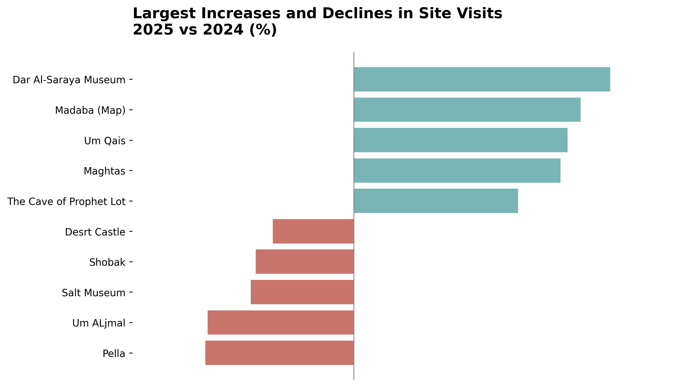
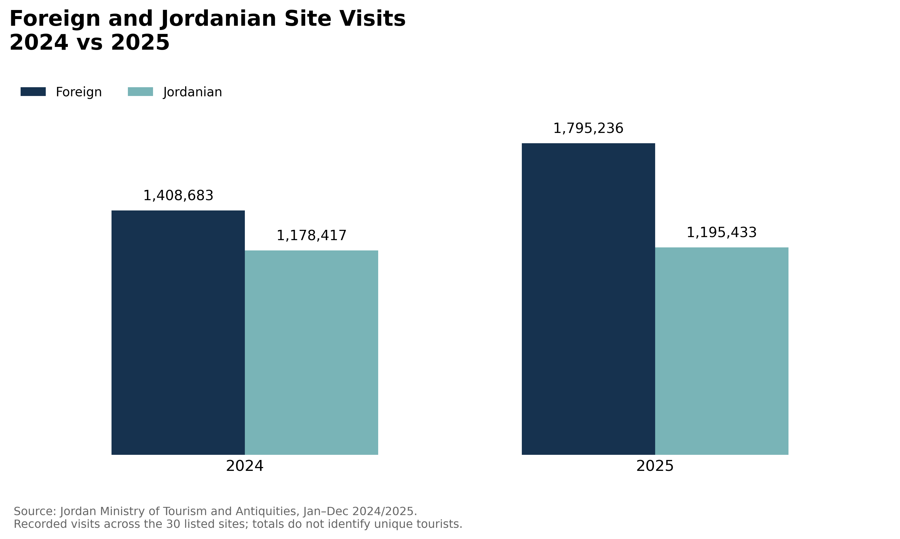

# Jordan Tourism Site Visits: 2024 vs 2025

An exploratory analysis of recorded visits to 30 tourist and archaeological sites in Jordan during January–December 2024 and 2025.

**Tools:** Python, pandas, Matplotlib, and Google Colab.

## Key findings

- **Most visited in 2025:** Petra, with **582,550 visits**, up **27.41%** from 2024.
- **Highest percentage growth:** Dar Al-Saraya Museum, from **4,523 to 6,976 visits** (**+54.23%**). Its increase of 2,453 visits was smaller than Petra's increase of 125,335, illustrating the difference between percentage growth and absolute change.
- **Largest percentage decline:** Pella, from **6,082 to 4,172 visits** (**−31.40%**). Jordanian visits fell from 2,962 to 800, while foreign visits increased from 3,120 to 3,372. The data does not establish the reasons for these changes.
- **Visitor category comparison:** Foreign visits grew **27.44%**, from 1,408,683 to 1,795,236. Jordanian visits grew **1.44%**, from 1,178,417 to 1,195,433.

## Visualizations

## Data source

**Jordan Ministry of Tourism and Antiquities.**

- [Official 2025 tourism site statistics page](https://mota.gov.jo/AR/List/زوار_المواقع_الاثرية_و_السياحية_لعام_2025)
- Workbook: `5.2_sites_12-2025.xlsx`.
- Report: *Number of Visitors to Touristic Sites by Locations During Jan. – Dec. 2024–2025*.

## Preparation and methods

Removed the report's seven heading rows, selected seven relevant columns, renamed them, and converted visitor counts to integers. Checked missing values, duplicate locations, zero 2024 baselines, and whether each site's two visitor categories add up to its reported total.

Site rankings and year-over-year growth use the published total columns. The foreign/Jordanian comparison sums the corresponding category columns across the 30 sites.

Percentage change = (2025 visits − 2024 visits) / 2024 visits × 100.

## Data quality note

One inconsistency was found in Hammamat Ma'in's 2024 figures: foreign visits (**12,662**) plus Jordanian visits (**50,476**) equal **63,138**, while the published total is **63,502**. The difference is **364 visits**. Published values were retained because the correct figure could not be verified. All 2025 rows passed the same reconciliation check.

## Run the notebook

1. Open `Jordan_tourism_analysis.ipynb` in Google Colab.
2. Upload `5.2_sites_12-2025.xlsx` to the Colab session so it is available at `/content/5.2_sites_12-2025.xlsx`.
3. Run the notebook cells from top to bottom.

The notebook uses pandas, Matplotlib, and an Excel reader such as openpyxl. Chart export cells save the three PNG files shown above.

## Scope and limitations

These figures count **site visits, not unique tourists**. They cover the **30 listed sites**, rather than all tourism activity in Jordan. Two annual observations support a year-to-year comparison; they do not establish longer-term trends or explain the causes of changes. Percentage growth should be interpreted alongside the starting count and absolute change.
